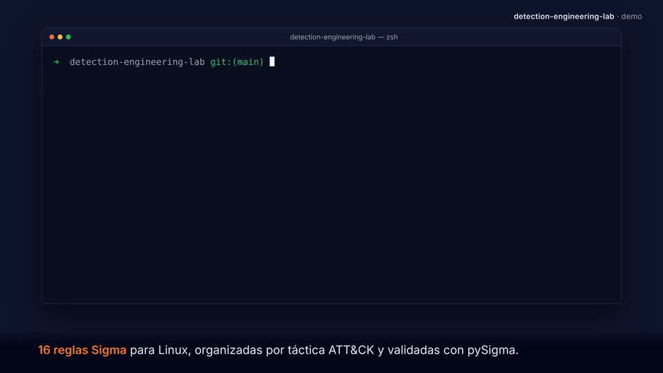

# detection-engineering-lab

[](https://github.com/inostroza-Daniela/detection-engineering-lab/actions/workflows/ci.yml)
[](https://inostroza-daniela.github.io/detection-engineering-lab/)
[](pyproject.toml)
[](rules/linux)
[](https://inostroza-daniela.github.io/detection-engineering-lab/attack-navigator.json)
[](LICENSE)

Laboratorio de ingeniería de detección para Linux: **16 reglas Sigma** (13 base y 3 correlaciones) mapeadas a **MITRE ATT&CK**, un **motor en Python** que las evalúa sobre eventos JSON con el formato de alertas de **Wazuh**, **logs de muestra** reproducibles con casos positivos y negativos por regla, una suite **pytest** que valida cada regla contra sus muestras, y un **sitio estático** con la matriz de cobertura.

Corre idéntico en macOS (Apple Silicon), Ubuntu y Windows. Python puro, sin binarios, sin red.

**Sitio:** <https://inostroza-daniela.github.io/detection-engineering-lab/>

## Demo



[Video completo (1 min, MP4)](docs/media/demo.mp4): validación, evaluación, la decodificación de argumentos hexadecimales de auditd que hace visible una reverse shell, los tests y el sitio de cobertura.

## En 30 segundos

```bash
git clone https://github.com/inostroza-Daniela/detection-engineering-lab.git
cd detection-engineering-lab
python -m venv .venv && source .venv/bin/activate   # Windows: .venv\Scripts\activate
pip install -e ".[dev]"

detectionlab validate                       # 16 reglas cargadas, todas válidas
detectionlab run samples --solo-disparos    # evalúa 400 eventos de muestra
pytest                                      # 152 tests
```

Con [uv](https://docs.astral.sh/uv/): `uv venv && uv pip install -e ".[dev]"`, el resto es igual.

## Qué hay

```
rules/linux/<tactica>/      reglas Sigma, una por archivo, con UUID estable
samples/<regla>/            positivos.jsonl y negativos.jsonl por regla
docs/reglas/<regla>.md      ficha de cada regla: qué detecta, lógica, falsos positivos, cómo probarla
docs/formato-eventos.md     esquema de eventos (Wazuh) y enrutamiento por logsource
docs/arquitectura.md        cómo funciona el motor y por qué se apoya en pySigma
docs/auditd/                política de auditd que alimenta las reglas
src/detectionlab/           motor, correlaciones, cobertura, informe, CLI
tests/                      pytest: una regla = un test positivo + uno negativo, más matcher, correlaciones, CLI y consistencia
```

## Reglas

| Regla | Nivel | Tácticas | Técnicas | Fuente |
|---|---|---|---|---|
| [`ssh_fallo_autenticacion`](docs/reglas/ssh_fallo_autenticacion.md) | base | Acceso a credenciales | T1110.001 | sshd |
| [`ssh_login_exitoso`](docs/reglas/ssh_login_exitoso.md) | base | Movimiento lateral | T1021.004 | sshd |
| [`ssh_fuerza_bruta`](docs/reglas/ssh_fuerza_bruta.md) | medio | Acceso a credenciales | T1110.001 | correlación `event_count` |
| [`ssh_login_exitoso_tras_rafaga`](docs/reglas/ssh_login_exitoso_tras_rafaga.md) | alto | Acceso inicial, Acceso a credenciales | T1110.001, T1078 | correlación `temporal_ordered` |
| [`cuenta_local_creada_o_agregada_a_sudo`](docs/reglas/cuenta_local_creada_o_agregada_a_sudo.md) | alto | Persistencia, Escalamiento de privilegios | T1136.001, T1098 | auditd |
| [`escalamiento_sudo_su_anomalo`](docs/reglas/escalamiento_sudo_su_anomalo.md) | medio | Escalamiento de privilegios | T1548.003 | auth (sudo, su) |
| [`modificacion_passwd_shadow`](docs/reglas/modificacion_passwd_shadow.md) | alto | Acceso a credenciales, Persistencia | T1003.008, T1098 | auditd |
| [`persistencia_cron`](docs/reglas/persistencia_cron.md) | medio | Persistencia | T1053.003 | auditd |
| [`persistencia_systemd`](docs/reglas/persistencia_systemd.md) | medio | Persistencia | T1543.002 | auditd |
| [`webshell_proceso_hijo_servidor_web`](docs/reglas/webshell_proceso_hijo_servidor_web.md) | alto | Persistencia, Ejecución | T1505.003, T1059.004 | auditd |
| [`reverse_shell`](docs/reglas/reverse_shell.md) | crítico | Ejecución, Comando y control | T1059.004, T1095 | auditd |
| [`descarga_y_ejecucion`](docs/reglas/descarga_y_ejecucion.md) | alto | Ejecución, Comando y control | T1105, T1059.004 | auditd |
| [`borrado_logs_historial`](docs/reglas/borrado_logs_historial.md) | alto | Evasión de defensas | T1070.002, T1070.003 | auditd |
| [`exfiltracion_dns`](docs/reglas/exfiltracion_dns.md) | alto | Exfiltración, Comando y control | T1048.003, T1071.004 | Suricata (dns) |
| [`conexion_saliente_sin_respuesta`](docs/reglas/conexion_saliente_sin_respuesta.md) | base | Descubrimiento | T1046 | Suricata (flow) |
| [`escaneo_red_saliente`](docs/reglas/escaneo_red_saliente.md) | alto | Descubrimiento | T1046 | correlación `value_count` |

La carpeta de cada regla es su táctica principal (la primera de la columna). Las tres reglas marcadas como **base** son de nivel informativo: no alertan solas, existen para que las correlaciones cuenten o encadenen eventos. Cobertura: 18 técnicas en 10 tácticas de ATT&CK Enterprise.

## El motor

```
eventos JSON (Wazuh) ─► enriquecer ─► enrutar por logsource ─► matcher ─► correlaciones ─► detecciones
```

- **Carga y validación** con [pySigma](https://github.com/SigmaHQ/pySigma): parseo del YAML, modificadores, resolución de referencias entre correlaciones y reglas, y una selección de sus validadores (condiciones colgantes, IDs duplicados, modificadores incompatibles, comodines mal escapados).
- **Matcher propio** que recorre el árbol de condición que entrega pySigma y compara valores contra el evento: comodines, `contains`/`startswith`/`endswith`, `re` con banderas, `all`, `cidr`, `gt`/`gte`/`lt`/`lte`/`neq`, `null`, `exists`, `fieldref`, `cased`, `base64`, `windash`, campos con lista y palabras clave. pySigma no trae un backend que evalúe eventos en memoria (sus backends convierten reglas a consultas de otros sistemas), así que se reutiliza su parser y se implementa solo la evaluación. El detalle está en [docs/arquitectura.md](docs/arquitectura.md).
- **Correlaciones** Sigma v2: `event_count`, `value_count`, `temporal` y `temporal_ordered`, con `group-by`, `aliases` y ventanas de tiempo. Una correlación puede referenciar otra correlación (`ssh_login_exitoso_tras_rafaga` lo hace). Las temporales exigen todas las reglas referenciadas; las detecciones sin valor para algún campo de `group-by` se descartan.
- **Enriquecimiento de auditd**: los argumentos que auditd escribe en hexadecimal se decodifican y se arma `data.audit.execve.cmdline`, el equivalente al `CommandLine` de Sysmon. Sin esto, `bash -c "bash -i >& /dev/tcp/..."` sería invisible.

## CLI

```bash
detectionlab validate                                   # sintaxis Sigma + metadatos (UUID, nivel, ATT&CK, falsos positivos, referencias)
detectionlab run samples/reverse_shell/positivos.jsonl  # tabla de disparos por regla
detectionlab run alerts.json --json                     # detecciones con grupo, cuenta y eventos de origen
detectionlab coverage --navigator capa.json             # resumen por táctica + capa para ATT&CK Navigator
detectionlab report --junit resultados.xml --salida site
detectionlab samples                                    # regenera samples/ con la semilla fija
```

`run` acepta archivos `.json` (lista u objeto), `.jsonl` y carpetas. Para un Wazuh real: `detectionlab run /var/ossec/logs/alerts/alerts.json`.

## Formato de eventos

Los eventos siguen el esquema de alertas de Wazuh (`timestamp`, `agent`, `rule`, `decoder`, `data.*`, `full_log`). Es una decisión de diseño: el siguiente repo del portafolio levanta Wazuh con Suricata y sus alertas entran aquí sin conversión. Las fuentes cubiertas son **sshd**, **sudo/su**, **auditd** y **Suricata eve.json** (dns y flow). Esquema completo y mapeo `logsource` → fuente en [docs/formato-eventos.md](docs/formato-eventos.md).

## Muestras y tests

`samples/` lo genera `src/detectionlab/muestras.py` con semilla fija: un escenario por regla, con eventos positivos (actividad maliciosa que debe disparar) y negativos (actividad legítima parecida que no debe disparar). Un test comprueba que regenerar las muestras produce bytes idénticos, así cualquier cambio en el generador queda a la vista en el diff.

La suite (`pytest --cov`, cobertura mínima 90 %) incluye:

- `test_reglas_muestras.py`: por cada regla, los positivos disparan y los negativos no.
- `test_matcher.py`: cada modificador y operador de condición.
- `test_correlacion.py`: ventanas, umbrales, orden temporal, alias, correlación sobre correlación.
- `test_consistencia.py`: falla si una regla no tiene ficha, muestras, UUID, nivel o mapeo ATT&CK, o si su carpeta no coincide con su táctica.
- `test_cli.py`, `test_motor.py`, `test_eventos.py`, `test_cobertura.py`.

## Sitio

`detectionlab report` genera `site/` con la matriz ATT&CK coloreada por cantidad de reglas, la tabla de reglas con nivel y estado de validación, métricas y la capa para Navigator. El workflow `pages.yml` lo construye y publica en cada push a `main`; `site/` no se versiona.

## Calidad

`ruff` (lint y formato), `mypy --strict`, `pre-commit` y `pytest-cov`, todo configurado en `pyproject.toml`. El CI corre lint y tipos, y luego la suite en una matriz Ubuntu × macOS (arm64) × Windows con Python 3.11 y 3.12.

## Límites y ampliaciones

- **Solo Linux.** Windows/Sysmon es la siguiente ampliación: el motor ya soporta cualquier `logsource` que se registre en `fuentes.py`, y los tests por regla no cambian.
- Los drop-ins de systemd (`*.service.d/`) y el barrido de hosts (un puerto, muchos destinos) están anotados en las fichas como ampliaciones directas.
- Las muestras son sintéticas, generadas con semilla fija. El siguiente repo del portafolio (`incident-response-lab`, en preparación) va a ejecutar estos ataques en un laboratorio Docker con Wazuh; sus alertas reales entrarían como un conjunto aparte (`samples/reales/`, fuera del generador) para no romper la reproducibilidad de las sintéticas.
- El catálogo ATT&CK va embebido (`attack.py`) para que todo corra sin red; incluye solo las técnicas que usan las reglas.

## Autora y licencia

**Daniela Inostroza Mancilla** · [LinkedIn](https://www.linkedin.com/in/daniela-inostrozam/) · [GitHub](https://github.com/inostroza-Daniela)

Publicado bajo licencia [MIT](LICENSE): puedes usar, copiar y modificar el código citando a la autora.
